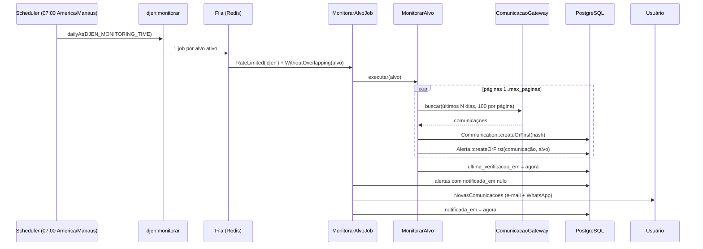
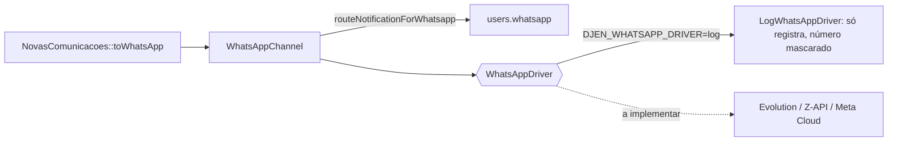

# 05 · Aba Monitoramento

O usuário cadastra **alvos**; todo dia o sistema busca as comunicações recentes de cada
alvo, guarda as novas e avisa por e-mail (e WhatsApp, quando houver driver real).

Rotas em `/monitoramento`, todas com `auth` + `verified` (e-mail confirmado):

| Método e rota                                | Nome                                 | O que faz                                       |
| -------------------------------------------- | ------------------------------------ | ----------------------------------------------- |
| `GET /monitoramento`                         | `monitoramento.index`                | Painel: alvos, alertas, preferências            |
| `POST /monitoramento/alvos`                  | `monitoramento.alvos.store`          | Cria alvo e dispara a 1ª verificação            |
| `PATCH /monitoramento/alvos/{alvo}`          | `monitoramento.alvos.update`         | Pausa/retoma (`ativo`) ou muda o apelido        |
| `DELETE /monitoramento/alvos/{alvo}`         | `monitoramento.alvos.destroy`        | Exclui alvo, alertas e comunicações órfãs       |
| `POST /monitoramento/alvos/{alvo}/verificar` | `monitoramento.alvos.verificar`      | Verifica agora (`throttle:6,1`)                 |
| `PATCH /monitoramento/alertas/{alerta}`      | `monitoramento.alertas.update`       | Marca um alerta como lido/não lido              |
| `POST /monitoramento/alertas/marcar-lidas`   | `monitoramento.alertas.marcar-lidas` | Marca todos como lidos                          |
| `PUT /monitoramento/notificacoes`            | `monitoramento.notificacoes.update`  | Salva o WhatsApp (opcional)                     |
| `DELETE /monitoramento/dados`                | `monitoramento.dados.destroy`        | LGPD: apaga todo o monitoramento (pede a senha) |

`/dashboard` (rota padrão do kit após o login) redireciona para `/monitoramento`.
A posse de alvos e alertas é checada por `MonitoringTargetPolicy` e `AlertaPolicy`.

## Alvos

| `tipo` (`TipoAlvo`) | `valor`                                  | `uf`        | Vira o filtro da API  |
| ------------------- | ---------------------------------------- | ----------- | --------------------- |
| `oab`               | OAB normalizada (`12345`, `11811N`)      | obrigatória | `numeroOab` + `ufOab` |
| `parte`             | nome, 3 a 120 caracteres, espaços únicos | —           | `nomeParte`           |
| `processo`          | 20 dígitos                               | —           | `numeroProcesso`      |

- Único por usuário + tipo + valor + UF ("Você já monitora este alvo").
- Limite de `DJEN_MONITORING_MAX_ALVOS` (50) alvos por usuário.
- `apelido` opcional (até 80) para identificar o alvo no painel e no e-mail.
- Alvo pausado (`ativo = false`) não é verificado.

## O fluxo diário



### Passo a passo

1. **Agendamento** (`routes/console.php`): `djen:monitorar` roda
   `dailyAt(DJEN_MONITORING_TIME)` no fuso `DJEN_MONITORING_TIMEZONE`, com
   `withoutOverlapping()` e `onOneServer()`.
2. **Comando** `djen:monitorar`: percorre os alvos ativos (`lazyById`) e enfileira um
   `MonitorarAlvoJob` por alvo. Com `--sync`, executa na hora, no próprio processo;
   com `--alvo=ID` (repetível), só os alvos indicados.
3. **Job** `MonitorarAlvoJob`:
    - middleware `RateLimited('djen')` (respeita o limite global de chamadas ao CNJ) e
      `WithoutOverlapping("monitorar-alvo:{id}")`;
    - recarrega o alvo e sai se ele foi pausado nesse meio-tempo;
    - chama `MonitorarAlvo::executar()`;
    - notifica os alertas pendentes.
4. **Serviço** `MonitorarAlvo::executar()`:
    - janela: de **hoje − `lookback_days`** (3) até **hoje**, no fuso configurado;
    - pagina de 100 em 100 até `max_paginas` (5) ou até a última página;
    - para cada comunicação, `Communication::createOrFirst(['hash' => ...])` e
      `Alerta::createOrFirst([...])`;
    - grava `ultima_verificacao_em`.
5. **Notificação** `NovasComunicacoes`: um e-mail por alvo com até 15 comunicações
   listadas ("… e mais N"), link para o painel e instrução de como parar. Se o usuário
   tiver WhatsApp, também vai pelo `WhatsAppChannel`.

### Por que a janela é de vários dias

O CNJ pode publicar com atraso, e o job pode falhar num dia. Olhar os últimos 3 dias
e deduplicar garante que nada se perde e nada se repete.

## Deduplicação (o coração do monitoramento)

Dois índices únicos fazem o trabalho, à prova de execuções simultâneas:

| Nível       | Índice único                                                    | Garante                                                                                       |
| ----------- | --------------------------------------------------------------- | --------------------------------------------------------------------------------------------- |
| Comunicação | `communications.hash`                                           | Cada comunicação é guardada uma vez, mesmo que vários alvos (de vários usuários) a encontrem. |
| Alerta      | `communication_target (communication_id, monitoring_target_id)` | No máximo um alerta por comunicação e alvo.                                                   |

E a notificação usa `notificada_em`:

- O job avisa **todos os alertas com `notificada_em` nulo**, não só os criados agora.
- Depois de enviar, marca `notificada_em`.
- Se o envio falhar (SMTP fora do ar), os alertas continuam pendentes e saem na
  próxima execução. O que já foi avisado **nunca** é avisado de novo.

> [!NOTE]
> No PostgreSQL, uma violação de índice único dentro de uma transação aborta a
> transação inteira. `createOrFirst` usa um savepoint por tentativa, então a corrida é
> segura também nos testes (que rodam dentro de transação).

## Tratamento de erros no job

| Situação                        | Reação                                                                       |
| ------------------------------- | ---------------------------------------------------------------------------- |
| `429` do CNJ                    | `release(Retry-After ou 60 s)` — volta para a fila mais tarde                |
| `403` (fora do Brasil) ou `4xx` | `fail()` — não adianta tentar de novo                                        |
| CNJ indisponível / timeout      | Exceção → até 5 tentativas, backoff de 60 s, 5 min e 15 min                  |
| Falha no `--sync`               | Isolada por alvo: registra, segue para o próximo, termina com código de erro |

## Datas são datas de calendário

`data_disponibilizacao` é um dia, sem hora. Compare sempre com `toDateString()`, nunca
como instante. Um bug real: no fuso de Manaus (UTC−4), comparar instantes excluía o
primeiro dia da janela.

## O painel

`MonitoramentoController` monta as props de `pages/Monitoramento/Index.vue`:

- `alvos`, com contagem de alertas e de não lidos;
- `alertas` paginados (20 por página), filtráveis por `alvo` e `status`
  (`nao_lidas` [padrão] | `lidas` | `todas`), ordenados pela data de disponibilização;
- `totalNaoLidas`, `notificacoes` (e-mail, WhatsApp, horário, janela), `tiposAlvo`,
  `ufs` e `limiteAlvos`.

Componentes: `monitoramento/FormAlvo`, `monitoramento/ListaAlvos`,
`monitoramento/PreferenciasNotificacao`, e os mesmos `CardComunicacao` e
`BarraExportacao` da Consulta.

## WhatsApp



- Número opcional, salvo só com dígitos e DDI: `55` + DDD + número (`^55\d{10,11}$`).
- Para plugar um provedor real: implemente `App\Notifications\WhatsApp\WhatsAppDriver`
  (`enviar(string $numero, WhatsAppMessage $mensagem)`) e registre em
  `AppServiceProvider::registerWhatsApp()`.

## Testando à mão

```bash
php artisan djen:monitorar --sync                 # tudo, agora
php artisan djen:monitorar --alvo=3 --sync        # só o alvo 3
php artisan schedule:test --name=djen:monitorar   # como o scheduler faria
```

Com `DJEN_GATEWAY=fake` e o seeder (`demo@advtaon.test` / `password`), dá para ver o
fluxo completo fora do Brasil; os e-mails aparecem no Mailpit (`http://localhost:8025`).
