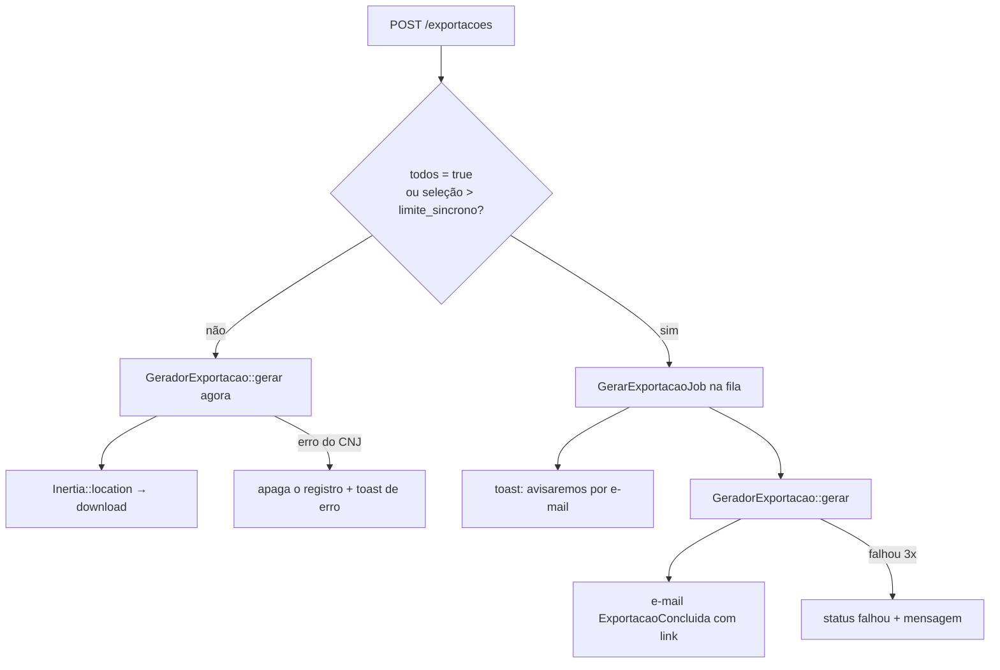

# 06 · Aba Exportação

Gera **CSV**, **Excel (XLSX)** ou **PDF** a partir da Consulta ou do Monitoramento.
Exige login (`auth` + `verified`).

| Método e rota                    | Nome                   | O que faz                                       |
| -------------------------------- | ---------------------- | ----------------------------------------------- |
| `GET /exportacoes`               | `exportacoes.index`    | Lista as últimas 50 exportações do usuário      |
| `POST /exportacoes`              | `exportacoes.store`    | Cria a exportação (`throttle:10,1`)             |
| `GET /exportacoes/{id}/download` | `exportacoes.download` | Baixa o arquivo (só o dono, `ExportacaoPolicy`) |
| `DELETE /exportacoes/{id}`       | `exportacoes.destroy`  | Apaga registro e arquivo                        |

## Síncrona ou na fila?



- Até `DJEN_EXPORT_LIMITE_SINCRONO` (100) itens **selecionados**: gera na hora e o
  navegador baixa o arquivo (`Inertia::location`). O "409" que aparece no console do
  navegador é o mecanismo do Inertia para isso, não é erro.
- "Todos os resultados" ou seleção maior: `GerarExportacaoJob` (3 tentativas, backoff
  30 s / 120 s, timeout 10 min) e e-mail `ExportacaoConcluida`. A página
  `Exportacao/Index` faz polling (`usePoll`) enquanto houver exportação em andamento.
- Exportações da Consulta chamam o CNJ, então o job usa `RateLimited('djen')`.
- Máximo de `DJEN_EXPORT_MAX_ITENS` (2000) comunicações por exportação.

## Status (`StatusExportacao`)

| Valor         | Rótulo  | Significado                           |
| ------------- | ------- | ------------------------------------- |
| `pendente`    | Na fila | Criada, aguardando o worker           |
| `processando` | Gerando | O gerador está rodando                |
| `concluida`   | Pronta  | Arquivo disponível até expirar        |
| `falhou`      | Falhou  | `erro` traz a mensagem para o usuário |

## O que é exportado: `parametros`

Gravado em `exports.parametros` (jsonb) e interpretado pelo `ColetorExportacao`:

**Origem `consulta`**

```json
{
    "filtros": { "oab": "12345", "uf": "AM" },
    "todos": false,
    "selecao": [
        { "pagina": 1, "hashes": ["abc...", "def..."] },
        { "pagina": 3, "hashes": ["..."] }
    ]
}
```

- Com seleção: o coletor **rebusca cada página** selecionada (normalmente vem do cache
  do `DjenClient`) e mantém só os hashes escolhidos, na ordem dos resultados. Um hash
  que sumiu da fonte é ignorado. Não guardamos o conteúdo selecionado no banco.
- Com `todos`: percorre as páginas de 100 em 100 até `max_itens` ou o fim.

**Origem `monitoramento`**

```json
{
    "filtros": { "alvo": 7, "status": "nao_lidas" },
    "todos": false,
    "selecao": [101, 102, 140]
}
```

- `selecao` são ids de alertas. Na hora de gerar, a posse é **revalidada**
  (`Alerta::doUsuario`), então um id de outro usuário nunca entra.
- Com `todos`: aplica `alvo` e `status` como no painel.

A validação fica em `StoreExportacaoRequest` (mesmas regras de filtro da Consulta;
cada página da seleção com até 100 hashes).

## Seleção no front

- `composables/useSelecao.ts` guarda a seleção como **chave → página**. Ela sobrevive à
  paginação (`preserveState`) e é limpa quando os filtros mudam.
- `components/BarraExportacao.vue` mostra a contagem, o formato e o botão; para
  visitantes, um convite para entrar.
- `composables/useExportar.ts` faz o `POST` e mostra um toast em caso de erro.

## Os arquivos

| Formato | Gerado por                                                | Detalhes                                                                   |
| ------- | --------------------------------------------------------- | -------------------------------------------------------------------------- |
| CSV     | `PlanilhaComunicacoes` (maatwebsite/excel)                | `;` como separador e BOM UTF-8 (abre direto no Excel em português)         |
| XLSX    | `PlanilhaComunicacoes`                                    | Mesmas colunas                                                             |
| PDF     | dompdf + `resources/views/exports/comunicacoes.blade.php` | A4, tudo escapado, `enable_font_subsetting` (sem isso o PDF passa de 1 MB) |

Colunas: data de disponibilização, tribunal, órgão julgador, tipo de comunicação, tipo
de documento, número do processo, destinatários, advogados, texto, link do documento.
Do monitoramento, mais **alvo** e **lida**.

Proteções nas planilhas:

- **Injeção de fórmula**: células que começam com `=`, `+`, `-` ou `@` recebem `'`
  na frente.
- **Tamanho**: o texto é cortado em 32 mil caracteres (o Excel aceita 32.767 por célula).
- O texto vai **sem HTML** (`ComunicacaoData::textoPuro()`, que descarta `<script>` e
  `<style>` inteiros e separa células de tabela).

Arquivos ficam no disco privado `DJEN_EXPORT_DISK` (padrão `local`) em
`exportacoes/{user_id}/{id}-{aleatório}.{ext}`. Nome do download:
`comunicacoes-{origem}-{AAAA-MM-DD-HHMM}.{ext}`.

## Retenção (LGPD)

- Expiram após `DJEN_EXPORT_DIAS_RETENCAO` (7) dias: o `model:prune` diário apaga o
  registro **e** o arquivo.
- Apagar a exportação (botão) apaga o arquivo junto (evento `deleting`).
- Excluir a conta apaga as exportações por Eloquent (`User::deleting`), para que os
  arquivos também saiam do disco. A FK em cascata, sozinha, deixaria arquivos órfãos.
