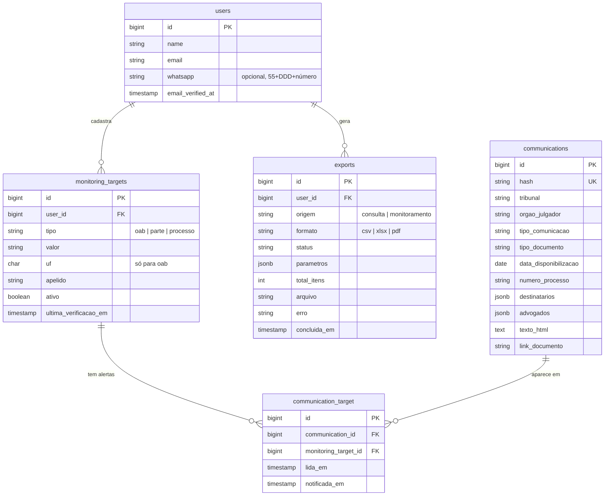
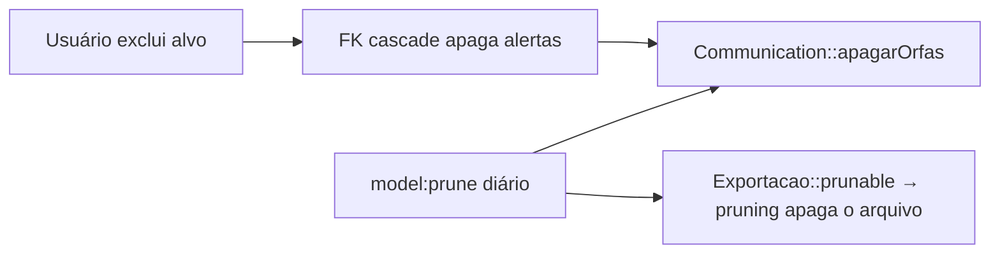

# 07 · Dados e LGPD

## Modelo de dados



| Tabela                 | Model              | Observações                                                                                          |
| ---------------------- | ------------------ | ---------------------------------------------------------------------------------------------------- |
| `users`                | `User`             | Do Starter Kit (Fortify, 2FA, passkeys) + coluna `whatsapp`.                                         |
| `monitoring_targets`   | `MonitoringTarget` | Único em `(user_id, tipo, valor, uf)`. Índice `(ativo, id)` para o comando diário.                   |
| `communications`       | `Communication`    | **Compartilhada entre usuários**, deduplicada por `hash`. Índices em data e processo.                |
| `communication_target` | `Alerta` (pivot)   | Único em `(communication_id, monitoring_target_id)`. Índice `(monitoring_target_id, lida_em)`.       |
| `exports`              | `Exportacao`       | Índice `(user_id, created_at)`.                                                                      |
| `search_logs`          | `RegistroBusca`    | Rastreio: uma linha por busca na Consulta. Ver [11 · Administração](11-administracao-e-rastreio.md). |
| `djen_api_calls`       | `ChamadaDjen`      | Rastreio: uma linha por requisição real à Comunica API.                                              |
| `activity_logs`        | `Atividade`        | Rastreio: trilha de eventos (páginas vistas, login, alvos, exportações...).                          |

Também existem as tabelas padrão do Laravel: `cache`, `jobs`, `failed_jobs`,
`sessions`, `password_reset_tokens` e `passkeys`.

### Por que `communications` é compartilhada

Se dez usuários monitoram a mesma OAB, a comunicação é guardada uma vez e ganha dez
alertas. Isso economiza espaço e chamadas, e a dedup fica no banco. O dono de uma
comunicação é, indiretamente, quem tem alerta para ela.

### Formato dos campos jsonb

```json
// communications.destinatarios
[{ "nome": "FULANO DE TAL" }]

// communications.advogados
[{ "nome": "CICLANA ADVOGADA", "numeroOab": "12345", "ufOab": "AM" }]
```

Guardamos só o **nome** dos destinatários (sem polo nem outros dados da API). O
PostgreSQL reordena as chaves de `jsonb`; nos testes, compare com `toEqual`, não `toBe`.

## LGPD

> O rastreio da área administrativa (`search_logs`, `djen_api_calls`, `activity_logs`)
> tem regras próprias de minimização e retenção: ver
> [11 · Administração e rastreio](11-administracao-e-rastreio.md#lgpd).

### Princípio: guardar o mínimo

- A **Consulta** não grava nada no banco. O resultado fica só no cache (10 min).
- O **Monitoramento** guarda apenas os campos exibidos no painel e no e-mail.
- Exportações expiram.
- O driver de WhatsApp `log` mascara o número no log.

### O que apaga o quê

| Ação                                         | Apaga                                                                                                                                                                       |
| -------------------------------------------- | --------------------------------------------------------------------------------------------------------------------------------------------------------------------------- |
| Excluir um alvo                              | o alvo, seus alertas e as comunicações que ficaram sem alvo (na hora)                                                                                                       |
| "Excluir todos os meus dados" (pede a senha) | todos os alvos e alertas, o WhatsApp e as comunicações órfãs                                                                                                                |
| Excluir a conta (Configurações)              | a conta, alvos e alertas (FK em cascata), exportações e seus arquivos; as comunicações órfãs saem no prune diário                                                           |
| Excluir uma exportação                       | o registro e o arquivo                                                                                                                                                      |
| `model:prune` diário (03:17)                 | comunicações sem alvo (`Communication::prunable`), exportações com mais de 7 dias (registro + arquivo) e rastreio (buscas, chamadas ao CNJ, atividade) com mais de 180 dias |



### Detalhe importante: cascata no banco não dispara eventos

As FKs têm `cascadeOnDelete()`, mas isso acontece no PostgreSQL, sem passar pelo
Eloquent. Para arquivos (que não estão no banco), isso não basta. Por isso:

- `User::deleting` apaga as exportações uma a uma por Eloquent, o que dispara o
  `deleting` de `Exportacao`, que apaga o arquivo.
- Comunicações órfãs são apagadas explicitamente (`apagarOrfas()`) logo após excluir
  um alvo ou "todos os meus dados". Na exclusão da conta, os alvos saem pela cascata
  e as comunicações órfãs ficam para o prune diário (no máximo um dia).

### Fixtures de teste

`tests/Fixtures/djen/comunicacao.json` foi derivada de uma resposta real, com nomes e
documentos **anonimizados** (chaves e tipos preservados). Toda fixture nova capturada
com `djen:capturar-fixture` precisa passar pelo mesmo cuidado antes do commit.
