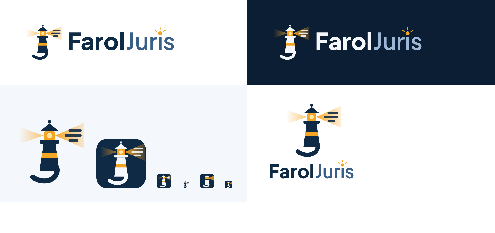

# 12 · Identidade visual FarolJuris

## Nome

**FarolJuris**, sempre junto, com "F" e "J" maiúsculos. Nunca "Farol Juris", "Faroljuris" ou
"FAROLJURIS". Em texto corrido, só o nome. No código, o nome vem de `APP_NAME`.

Slogan sugerido: _"Suas intimações do DJEN, todo dia, antes do prazo."_

> [!NOTE]
> O repositório no GitHub continua `samuelsonbrito/ADVTaOnSearch`. Renomear é uma opção
> nas configurações do GitHub (o endereço antigo passa a redirecionar).

## O símbolo

Um **farol cuja luz revela as publicações**:

- o feixe da direita mostra linhas de texto: é o farol "lendo" o diário por você;
- a base se curva como uma onda e, com a torre, desenha o **J** de Juris;
- no nome escrito, o pingo do "i" de Juris é uma luz âmbar.

## Arquivos

| Arquivo                                                     | Uso                                                   |
| ----------------------------------------------------------- | ----------------------------------------------------- |
| `branding/faroljuris/faroljuris-logo.svg`                   | Horizontal, fundo claro (site, e-mail, documentos)    |
| `branding/faroljuris/faroljuris-logo-escuro.svg`            | Horizontal, fundo escuro                              |
| `branding/faroljuris/faroljuris-logo-empilhada.svg`         | Símbolo sobre o nome (capas, login, materiais)        |
| `branding/faroljuris/faroljuris-icone.svg`                  | Só o símbolo, fundo transparente                      |
| `branding/faroljuris/faroljuris-icone-app.svg`              | Ícone de app e redes sociais (quadrado arredondado)   |
| `branding/faroljuris/faroljuris-favicon.svg`                | Versão simplificada para tamanhos pequenos (16–32 px) |
| `public/favicon.svg`, `favicon.ico`, `apple-touch-icon.png` | Ícones do site (gerados a partir do favicon)          |

Os textos dos SVGs estão convertidos em contornos (fonte Plus Jakarta Sans), então abrem
iguais em qualquer lugar.

## No app

| Componente                   | O que é                                                               |
| ---------------------------- | --------------------------------------------------------------------- |
| `components/AppLogoIcon.vue` | O farol. Torre em `currentColor`, luz sempre âmbar.                   |
| `components/MarcaNome.vue`   | O nome: "Farol" em negrito + "Juris" em `--marca-juris`.              |
| `components/AppLogo.vue`     | Quadrado azul-marinho com o farol + nome (barra lateral e cabeçalho). |
| `layouts/PublicLayout.vue`   | Mesmo par no topo das páginas públicas.                               |

## Cores

| Token             | Valor                              | Papel                                                         |
| ----------------- | ---------------------------------- | ------------------------------------------------------------- |
| `--marca-marinho` | `#0f2a44`                          | Cor principal: confiança, tom jurídico. Botões no tema claro. |
| `--marca-ambar`   | `#f5a524`                          | A luz do farol: destaques e botões no tema escuro.            |
| `--marca-luz`     | `#ffe7a8`                          | Brilho da lanterna (só no símbolo).                           |
| `--marca-claro`   | `#f4f7fb`                          | Símbolo sobre o azul-marinho.                                 |
| `--marca-juris`   | `#3a5f86` claro / `#9db8d6` escuro | "Juris" no nome escrito.                                      |

- **Tema claro**: fundo branco, neutros levemente azulados, primária azul-marinho com texto
  branco (contraste 14,6:1).
- **Tema escuro** ("noite de farol"): fundo azul-marinho profundo `#0b1726`, cartões `#0f1e30`,
  primária âmbar com texto azul-marinho (7,2:1).
- Texto secundário: `#5b6b7f` no claro (5,4:1) e `#9aacbf` no escuro (7,2:1), acima do mínimo
  de 4,5:1.
- Os gráficos da área administrativa têm paleta própria (`--viz-*`), validada nos dois temas.

## Tipografia

Plus Jakarta Sans (variável, servida localmente por `@fontsource`). Títulos em peso 600–800,
texto em 400–500.

## Usos a evitar

- Separar o nome ("Farol Juris") ou trocar as cores das duas partes.
- Esticar, girar ou recolorir o farol (a luz é sempre âmbar).
- Usar o símbolo completo, com as linhas de texto no feixe, abaixo de 32 px: use o favicon.
- Pôr "CNJ", "DJEN" ou "PJe" junto da marca: o FarolJuris não é um serviço oficial.
