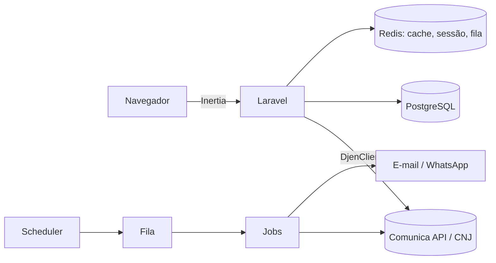
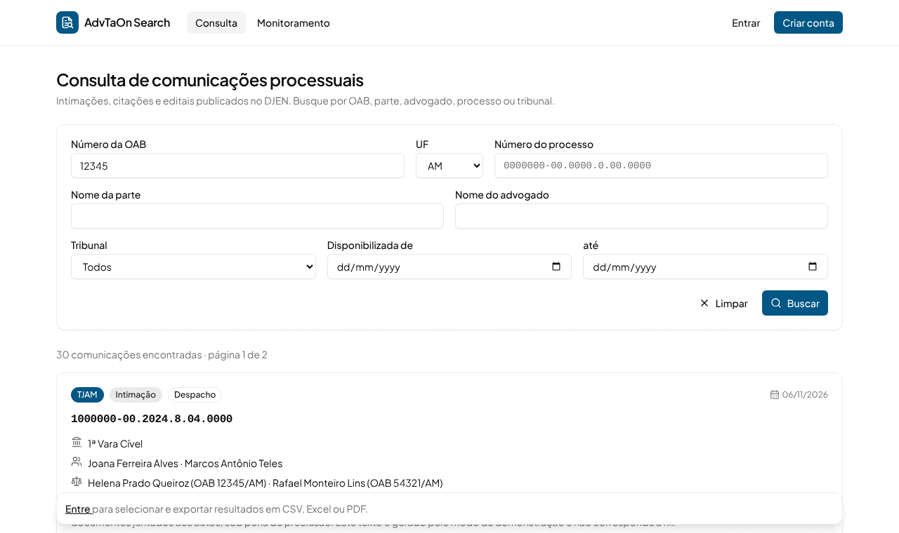
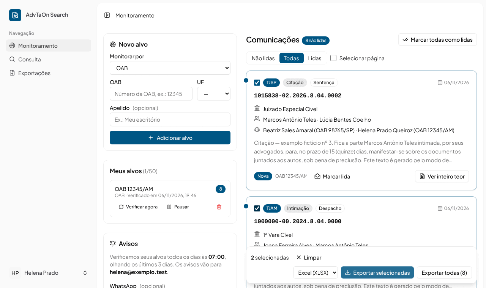
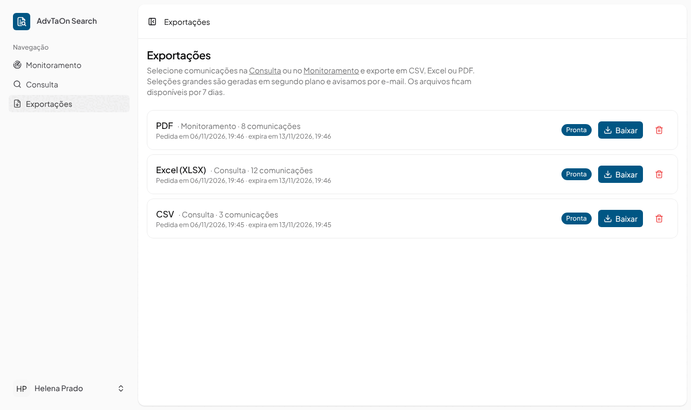

# Documentação do FarolJuris

Esta pasta explica **o que** o sistema faz, **como** ele está organizado e **por que**
algumas decisões foram tomadas. O [README da raiz](../README.md) é o guia rápido de
instalação; o [CLAUDE.md](../CLAUDE.md) é o resumo técnico para quem (pessoa ou agente)
vai mexer no código.

## Por onde começar

| Se você quer...                              | Leia                                                            |
| -------------------------------------------- | --------------------------------------------------------------- |
| Entender o produto e o vocabulário jurídico  | [01 · Visão geral e glossário](01-visao-geral.md)               |
| Ter o mapa do código e das camadas           | [02 · Arquitetura](02-arquitetura.md)                           |
| Entender como falamos com o CNJ              | [03 · Integração com o DJEN](03-integracao-djen.md)             |
| Mexer na busca pública                       | [04 · Aba Consulta](04-consulta.md)                             |
| Mexer nos alertas diários                    | [05 · Aba Monitoramento](05-monitoramento.md)                   |
| Mexer em CSV/XLSX/PDF                        | [06 · Aba Exportação](06-exportacao.md)                         |
| Saber o que fica no banco e quando é apagado | [07 · Dados e LGPD](07-dados-e-lgpd.md)                         |
| Mexer nas telas Vue                          | [08 · Front-end](08-frontend.md)                                |
| Rodar, testar e contribuir                   | [09 · Desenvolvimento](09-desenvolvimento.md)                   |
| Colocar no ar, operar e resolver problemas   | [10 · Operação e deploy](10-operacao-e-deploy.md)               |
| Ver uso, buscas e rastreio (área interna)    | [11 · Administração e rastreio](11-administracao-e-rastreio.md) |
| Usar a marca, a logo e as cores              | [12 · Identidade visual](12-identidade-visual.md)               |
| Publicar no Ploi (VPS Hostinger)             | [13 · Deploy no Ploi](13-deploy-ploi.md)                        |

## O sistema em um parágrafo

O FarolJuris é uma aplicação Laravel 13 + Vue 3 (Inertia) que lê as comunicações
processuais (intimações, citações, editais) publicadas no **DJEN** através da
**Comunica API** do CNJ. Qualquer pessoa pode **consultar**; quem tem conta pode
**monitorar** uma OAB, uma parte ou um processo e receber por e-mail só o que é novo; e
pode **exportar** os resultados em CSV, Excel ou PDF. Uma **área administrativa** interna
mostra o uso da plataforma e a saúde da integração com o CNJ. O navegador nunca fala com o CNJ:
todas as chamadas passam pelo nosso backend, que precisa rodar **com IP no Brasil**.

## Telas

| Consulta                      | Monitoramento                           | Exportações                         |
| ----------------------------- | --------------------------------------- | ----------------------------------- |
|  |  |  |

## Mantendo estes documentos

- Mudou um comportamento descrito aqui? Atualize o arquivo no mesmo PR.
- Os nomes de campos da API citados vêm da resposta real em `tests/Fixtures/djen/`.
  Não documente campos que não aparecem lá.
- Os diagramas usam Mermaid, que o GitHub renderiza direto.
